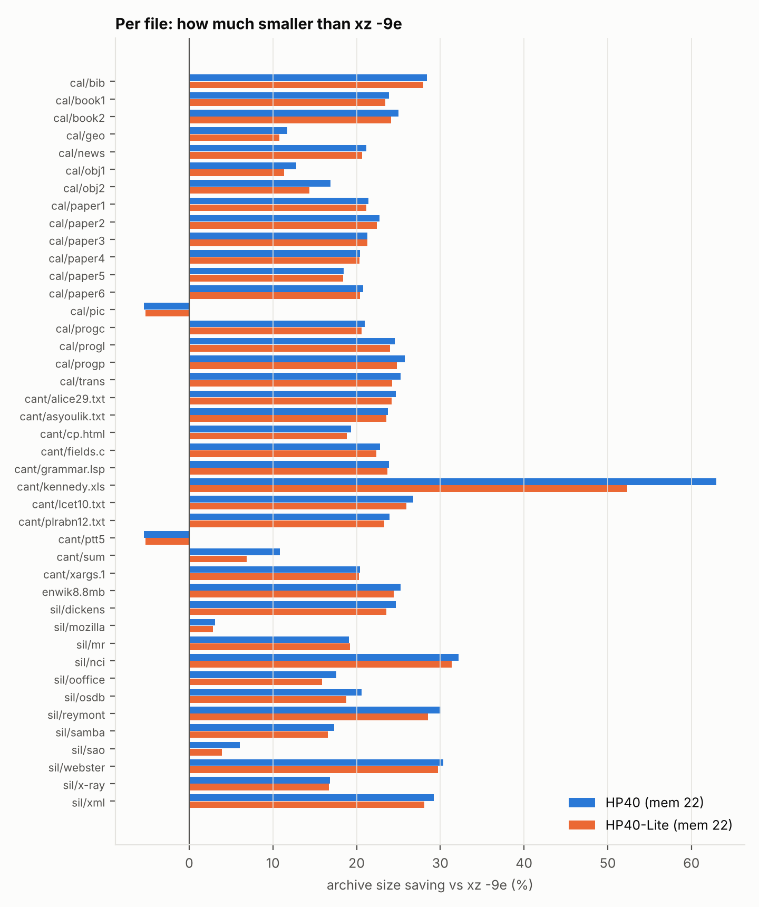
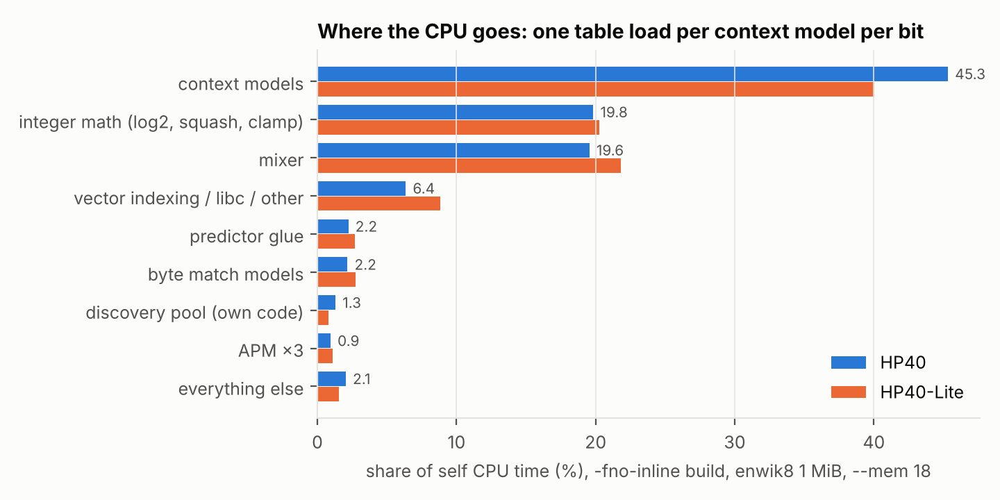
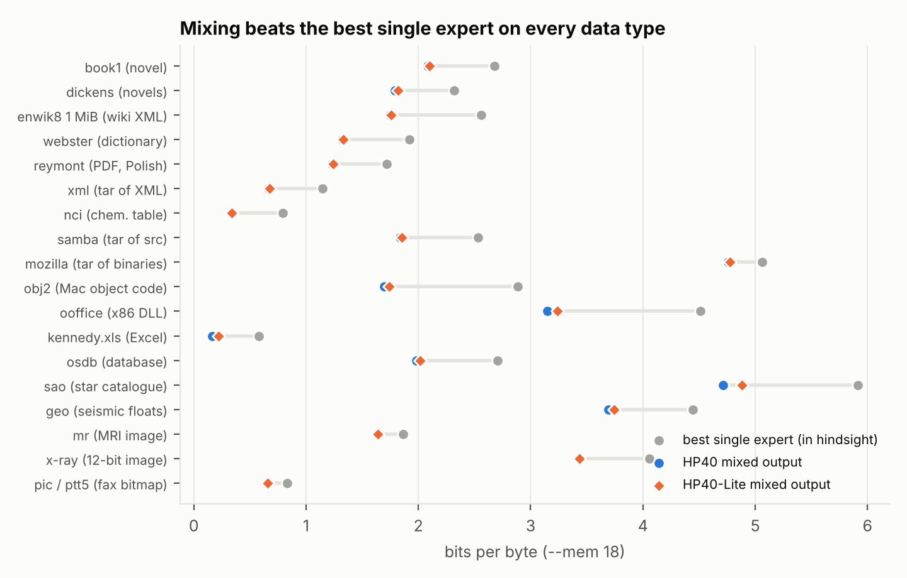
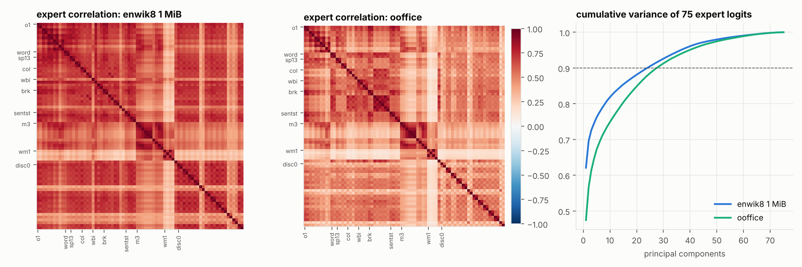
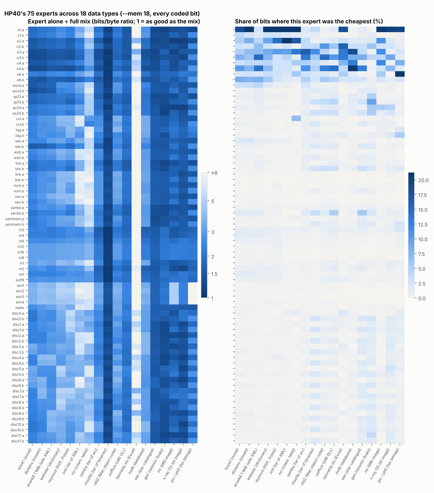
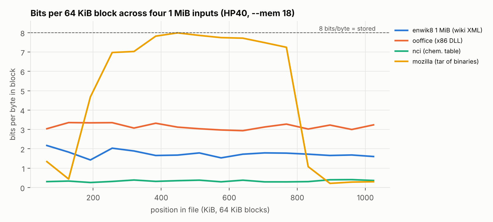
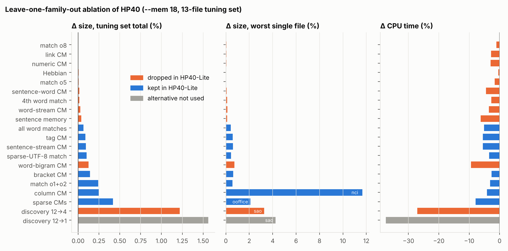
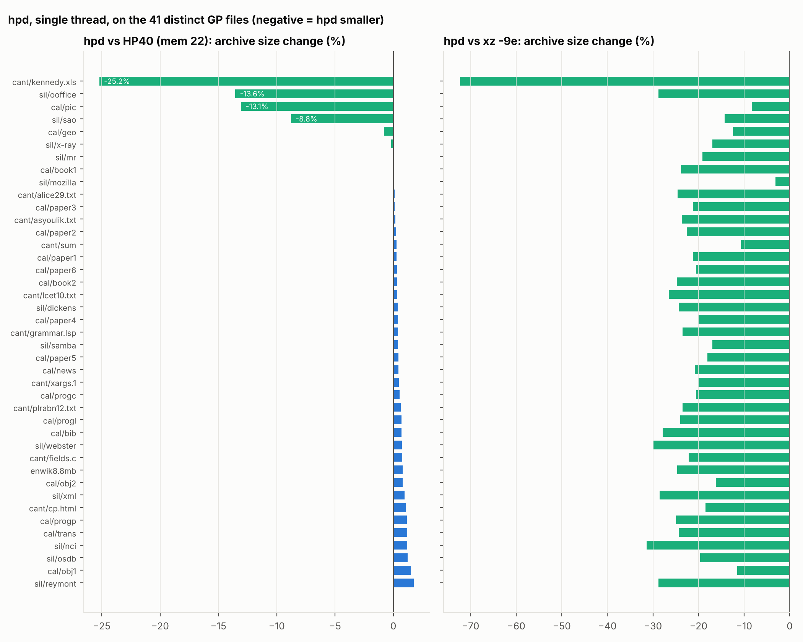
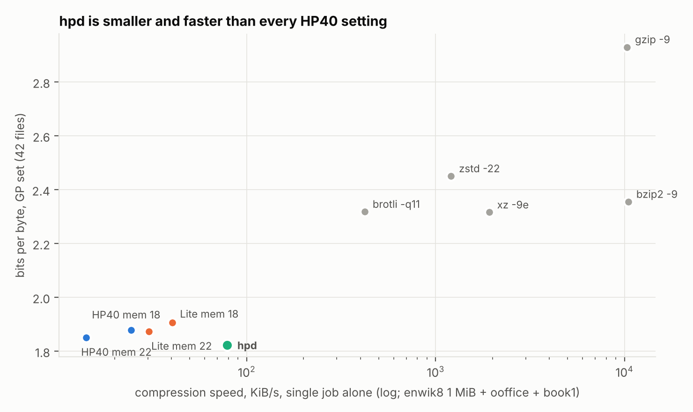

**Code, data and scripts:** <https://github.com/odin-loki/HPv40-Compression-Algorithm> ·
**Source package:** `hpd-1.2.0-src.zip` (§18) ·
**Status:** Research report in two parts. All numbers are measured in this
study unless cited to the upstream lab log.

## Abstract

HP40 is champion v40 of the `hp` Hutter-Prize lab
([odin-loki/CompressionAlgorithm](https://github.com/odin-loki/CompressionAlgorithm)):
an integer-exact, bitwise context-mixing (CM) compressor whose 75 experts and
39 accepted compile switches were all tuned on Wikipedia XML. We rebuild it
byte-exactly (1,721,462 bytes on the first 8 MiB of enwik8, matching the lab
log) and ask whether it is a good **general-purpose** compressor.

On a 27 MB, 42-file mix of the Calgary, Canterbury, Silesia (first MiB of
each file) and enwik8 corpora, HP40 at its tuned setting writes
**6,256,158 bytes (1.851 bits/byte): 20.1% smaller than xz -9e and brotli-11**,
and HP40 or Lite writes the smallest archive on 39 of 41 distinct files. The exceptions are a
fax bitmap, where xz wins by 5.4%, and one 13 KB English paper, where brotli's
dictionary wins by 21 bytes. Its cost is the problem. At `--mem 22` it codes at
**8 KiB/s in both directions** and commits **10.6 GiB** of RAM to every file,
including a 3.7 KB one. Profiling shows it is memory-latency bound: 95% of
context-model time is one random table load per model per bit. Two word tables
with 2³¹ slots each hold 73% of its memory, and on this VM the table zeroing
alone costs 17–36 s per file.

Mining every expert's prediction on every bit of 18 data types shows that
mixing beats the best single expert by 6–72% (median 27%). The 75 expert
logits have an effective rank of only 1.6–7.2. Plain order-1…6 models and an
online context-discovery pool win 76% of all bits. Seven Wikipedia-specific
families win under 1% each.

Leave-one-out and add-back ablations on a separate tuning set yield
**HP40-Lite**, which keeps **43 of the 75 experts**. It drops ten near-redundant
families and shrinks the discovery pool from 12 to 4 slots. Lite is **1.21%
larger** than HP40 (6,332,030 bytes, still 19.1% below xz -9e), and takes
**44–52% less time with about 40% less memory**. It dominates HP40 at every table
size below the largest: Lite at `--mem 22` is smaller and faster than HP40 at
`--mem 18`.

Shrinking the tables is the bigger lever. At `--mem 16` (195 MiB) HP40 still
beats xz -9e by 17.3%. We give six engineering changes, all aimed at layout,
allocation and data-type gating rather than new models. The upstream lab
independently adopted three of them after v40.

Part II applies these findings. **hpd** is HP40-Lite rebuilt around the
profile: cache-line buckets with checksums, demand-zero tables, a record
model, an x86 transform, pass-through of incompressible data and parallel
blocks. It is **1.55% smaller than HP40, 5.6× faster and uses 1/18 of its
memory**, writing **1.823 bits/byte on the GP set (21.3% below xz -9e)** and
1.474 bits/byte on the full 212 MB Silesia corpus (19.4% below xz -9e), the
smallest archive of every tested compressor on 40 of 41 GP files and all 12
Silesia files. A GPU build writes byte-identical archives, but on an RTX 3090
it only reaches 0.84–0.95× the speed of a 64-thread CPU, and the small shards
it needs cost 27–45% in ratio.

**Headline numbers for HP40 and HP40-Lite (GP set, 27,033,797 bytes):**

| system | bytes | bits/byte | vs xz -9e | compress speed* | peak RSS |
|---|---:|---:|---:|---:|---:|
| HP40, `--mem 22` | 6,256,158 | 1.851 | −20.1% | 8.3 KiB/s | 10.6 GiB |
| HP40-Lite, `--mem 22` | 6,332,030 | 1.874 | −19.1% | 18.1 KiB/s | 6.2 GiB |
| HP40, `--mem 18` | 6,348,580 | 1.879 | −18.9% | 14.7 KiB/s | 704 MiB |
| HP40-Lite, `--mem 18` | 6,440,845 | 1.906 | −17.7% | 25.1 KiB/s | 418 MiB |
| xz -9e | 7,827,736 | 2.316 | 0 | 1,127 KiB/s | 138 MiB |
| brotli -q11 -w24 | 7,835,477 | 2.319 | +0.1% | 344 KiB/s | 111 MiB |

\*Whole-set wall time including start-up; HP runs shared the 4-core VM
(§4.2). Single-job timings are in Table 3.

## Contents

**Part I — HP40 and HP40-Lite as general-purpose compressors.**
1. Introduction · 2. The systems under test · 3. Method · 4. Results · 5. Profiling · 6. Data-mining the experts · 7. Designing HP40-Lite from the data · 8. Discussion · 9. Conclusion

**Part II — hpd: turning HP40 into a day-to-day compressor.**
10. Method · 11. Speed: removing the DRAM wait · 12. Memory and start-up · 13. Ratio: models for data HP40 never saw · 14. Results on the GP set (42 files, single thread) · 15. Full Silesia, 4 threads · 16. Portability · 17. What is still weak · 18. Source code · 19. On the GPU · 20. Conclusion

**Appendices.** A. Reproducing Part I · B. Per-file archive bytes

# Part I — HP40 and HP40-Lite as General-Purpose Compressors

## 1. Introduction

`hp` is an integer-exact context-mixing compressor written for the Hutter
Prize: every model, gate and size in it was accepted or rejected by its
effect on Wikipedia XML (enwik8). Its champion **v40** (HP40) reached
1,721,462 bytes on the first 8 MiB of enwik8, 25% smaller than xz -9e. A
later descendant (v78, "gate24") is vendored into Cypha as CyphaLM's byte
predictor (`native/third_party/hp`).

This paper asks a different question: **is HP40 a good general-purpose
compressor?** General-purpose means three things a Hutter-Prize score does
not measure:

1. **Ratio on data it was not tuned on**: executables, databases, images,
   spreadsheets, PDFs, tarballs and small files, not just Wikipedia.
2. **Cost**: time, memory and start-up for real file sizes, and how those
   scale with the `--mem` table-size knob.
3. **Efficiency of the model set**: how many of its 75 experts earn their
   keep on general data, and what a lighter variant, **HP40-Lite** (fewer
   experts), gives up.

We answer by reproducing HP40 byte-exactly from the upstream lab, running
it and Lite against seven standard compressors on 42 files (27 MB) from four
corpora at four table sizes, profiling it at the function, instruction and
memory level, and **mining** its experts: we log every expert's prediction
on every coded bit of 18 data types to see which experts win, how
redundant they are, and where the mixing gain comes from. The expert set for
Lite is chosen from leave-one-out and add-back ablations on a separate
tuning set, not by hand.

### Contributions

* A byte-exact rebuild of HP40 from the lab log (39 compile switches and a
  table-size cap over the v47-era tree), with the recipe and a five-switch patch that makes every
  expert family removable (`data/v40_flags.txt`,
  `patches/hp40_lite_switches.patch`).
* The first general-purpose evaluation of HP40: 16 configurations ×
  42 files, every archive size, time and peak RSS recorded
  (`data/*.jsonl`).
* A CPU and memory profile that locates the bottleneck (one random DRAM load per
  context model per bit) and the memory (two 4 GiB word tables), with an
  analytic memory model that matches measured RSS within 4%.
* An expert-level data-mining study over 18 data types: standalone costs,
  win shares, correlation spectra, mixing gains, bit-position costs and
  learning curves.
* **HP40-Lite**, 43 of 75 experts, chosen by measured ablation: 1.2%
  larger than HP40, 44–52% less time, about 40% less memory.
* Concrete engineering recommendations, three of which the upstream lab
  independently adopted after v40.

## 2. The systems under test

### 2.1 Lineage and the v40 recipe

`hp` is the integer-exact context-mixing (CM) compressor in
[odin-loki/CompressionAlgorithm](https://github.com/odin-loki/CompressionAlgorithm)
(vendored into Cypha as `native/third_party/hp`, reduced to the later *gate24*
recipe). The upstream tree is an ablation lab: every model and mixer change is
a compile-time switch in `hp/include/hp/features.hpp`, and the lab log
(`RECORD.md`) accepts or rejects one switch at a time on the first 8 MiB of
enwik8 at `--mem 22`. Accepted switches stack into numbered champions
(v5 … v93).

**HP40** is champion **v40** of that log:

> `v40 = v39 + o3/o4+5 — 1,721,462 / 1.641 bpc, RT PASS` (`RECORD.md` line 827)

The repository keeps only the *latest* champion's flag file
(`hp/tools/v78_flags.ps1`, which now tracks v93), and the current upstream
defaults have drifted (most later flags are now default-on and `HP_SLOT_MAX` is
hard-capped at 22). v40 therefore cannot be rebuilt from upstream HEAD. We
rebuilt it from the oldest commit that still has every v40 switch individually
controllable (`0b1ced2`, 2026-09-12, the v47 board) with the default flag set
plus the 39 switches accepted between v5 and v40 and the `SLOT_MAX=32` cap,
walked in order from the log
(`data/v40_flags.txt`):

| step | switch(es) accepted | 8 MiB bytes (log) |
|---|---|---:|
| v5 | `MIXER_SKIP=24`, `SPARSE_UTF8` | 1,798,335 |
| v6–v7 | `SENWORD`, `GATE_ARGMAX` | 1,795,356 |
| v8–v10 | `SLOT_GROW` (replaced v8's `SLOT_SIZES`), `GATE_WORDPOS`, `STATE_TABLE2`, `SLOT_GROW_EXTRA` | 1,781,301 |
| v11–v13 | `SENT_STREAM`, `MATCH_18`, `QUOTE_STACK` | 1,775,314 |
| v14–v25 | `SLOT_WORD2…9` (word/wbi tables +8 bits), `MATCH_01/02`, `WMATCH_4`, `SLOT_S3`, `SLOT_WSTR2`, `SLOT_MAX` 29→31 | 1,747,228 |
| v26–v28 | `SENT_MEM`, `SLOT_S4`, `MATCH_05` | 1,745,709 |
| v29–v40 | `SLOT_O34…O34E`, `SLOT_O6…O6F`, `MATCH_GROW`, `SLOT_MAX=32` | **1,721,462** |

Of the 39 switches, 25 only **grow hash tables** (they add table bits to the
order-3/4/6, word, word-bigram and sentence models). That fact dominates
HP40's memory profile (§5.3).

**Reproduction.** Built with GCC 13.3, `-O3 -march=native -std=c++20`, the
rebuilt HP40 compresses `enwik8.8mb` (SHA-256 `09f6dd72…ee8e`) at `--mem 22`
to **1,721,462 bytes**, byte-identical to the log entry. This is the anchor
for every other number in the paper.

### 2.2 HP40-Lite

HP40-Lite is HP40 with **fewer experts**: the same code, flags and archive
format family, with whole expert families switched off. Five of the families
had no switch upstream (the sparse `sp13/sp24`, column, tag and word-bigram
context models, and the Hebbian expert), so we added five default-on switches
(`patches/hp40_lite_switches.patch`). With every switch at its default the
patched tree reproduces HP40 byte-for-byte: identical archives on three test
files, and it decodes HP40's 8 MiB anchor archive exactly (§4.3). Which families Lite drops is decided by data in §7, not by hand.

### 2.3 Per-bit pipeline

Every byte is coded MSB-first as eight binary decisions; encoder and decoder
run the same predictor, so the compressor is symmetric in time and memory.

```
 byte history ──► EXPERTS (75 stretched logits + bias)
                  │ 18 hashed context models × 2 outputs  (bit-history StateMap + Pitman–Yor direct)
                  │  9 byte-match models (orders 1,2,3,4,5,6,8,10,16)
                  │  1 sparse-UTF-8 match, 4 word-keyed match models
                  │  1 Hebbian word-association expert
                  │ 12 discovery-pool slots × 2 outputs (online MDL-selected context masks)
                  ▼
                MIXER: 10 layer-1 logistic mixers, each gated on a different
                  context (partial byte c0, GRIA entropy regime, previous byte,
                  match length, entropy bucket, Hebbian strength, wiki state,
                  pattern class, loudest-expert identity, in-word position);
                  layer 2 mixes their 10 outputs, gated on c0
                  ▼
                APM ×3 (c0; previous byte×c0; GRIA bucket×c0) → final p (12-bit)
                  ▼
                32-bit binary arithmetic coder
                  ▼
                update(bit): every table, mixer weight and APM learns online
```

There is no floating point anywhere in the codec path, so archives are
bit-reproducible across machines (§4.3).

### 2.4 Expert inventory

| family | models | mixer inputs | context | table bits @ mem 22 |
|---|---|---:|---|---:|
| order-n CMs | o1, o2, o3, o4, o6 | 10 | last n bytes | 22, 22, 27, 27, 28 |
| word CM | word | 2 | hash of current word | **31** |
| sparse CMs | sp13, sp24 | 4 | bytes 1,3 / 2,4 back | 22 |
| column CM | col | 2 | byte above in previous line | 22 |
| tag CM | tag | 2 | markup nesting / wiki context key | 25 |
| word-bigram CM | wbi | 2 | previous word × current word | **31** |
| word-stream CM | wstr | 2 | first-char / previous-word streams | 25 |
| bracket CM | brk | 2 | open-bracket/quote stack | 22 |
| link CM | link | 2 | wiki link word | 25 |
| numeric CM | num | 2 | numeric field state | 22 |
| sentence-word CM | sen | 2 | body-prose word hash | 25 |
| sentence-stream CM | sentst | 2 | sentence-boundary word | 26 |
| sentence-memory CM | sentmem | 2 | hash of a similar earlier sentence | 22 |
| byte match | m1 … m16 | 9 | longest match at 9 orders | buffer 26, index 23 |
| sparse-UTF-8 match | sutf8 | 1 | gap-1 match for escaped UTF-8 | 26 / 23 |
| word match | wm1 … wm4 | 4 | match keyed on 1–4 previous words | 26 / 23 |
| Hebbian | hebb | 1 | learned word→word association | 22 |
| discovery pool | disc0 … disc11 | 24 | online-selected 16-byte masks | 22 |
| bias | — | 1 | partial byte | — |
| **total** | **45 models** | **76** | | |

Most of the families above were built for Wikipedia XML (enwik8/9 is the
Hutter Prize corpus): `tag`, `link`, `brk`, `sen`, `sentst`, `sentmem`, the
wiki-state mixer gate, and the word families. A general-purpose compressor has
to cope with executables, databases, images, PDFs and tarballs too; how these
text-specialist experts behave on such data is one of the questions the paper
answers.

## 3. Method

### 3.1 Corpora

| set | files | bytes | role |
|---|---:|---:|---|
| **Canterbury** (classic) | 11 | 2,810,784 | small mixed files: text, C, Lisp, HTML, man page, Excel, fax image, SPARC binary |
| **Calgary** (large) | 18 | 3,251,493 | text, papers, source, object code, geophysics data, image, news |
| **Silesia-1M**: first 1 MiB of each Silesia file | 12 | 12,582,912 | modern mix: tar of source, x86 DLL, MRI, databases, PDF, XML, star catalogue, X-ray |
| **enwik8.8mb** | 1 | 8,388,608 | the Hutter-Prize text HP40 was tuned on |
| *General-purpose (GP) set* = all of the above | **42** | **27,033,797** | headline evaluation |
| *Tuning set*: 256 KiB from offset 4 MiB of each Silesia file + 512 KiB of enwik8 at offset 60 MB | 13 | 3,670,016 | Lite expert search only (disjoint from the GP set) |
| Silesia, full (baselines only) | 12 | 211,938,580 | context for the 1 MiB truncation |

Silesia is truncated to 1 MiB per file because HP40 runs at roughly 10 KB/s
(§4.2); the full corpus would take about seven hours per direction per setting.
The tuning set is cut from different offsets of the same files and from a
different region of enwik8, so the expert choice for Lite is not fitted to
the evaluation bytes.

### 3.2 Baselines

gzip 1.12 `-9`; bzip2 1.0.8 `-9`; xz 5.4.5 `-9e` (single thread);
zstd 1.5.5 `-19 --long=27` and `--ultra -22 --long=27` (single thread);
brotli 1.1.0 `-q 11 -w 24`; lz4 1.9.4 `-12`. All run as stdin→stdout
pipes. These are the general-purpose tools a user would otherwise choose.
No other CM compressor (paq8px, cmix) was run, so HP40's standing among CM
compressors is outside the scope of this study.

### 3.3 Settings

HP40 is evaluated at its tuned setting `--mem 22` and swept over
`--mem 16, 18, 20` to map the memory/ratio trade-off. The Lite search runs
at `--mem 18` (700 MB per job, so four jobs fit in RAM; at `--mem 20` four
parallel jobs spent a large share of their time zeroing pages); the chosen Lite is
then evaluated at every setting HP40 is.

### 3.4 Measurements

* **Size**: archive bytes including HP's 29-byte header; bits per byte
  (bpc) = 8 × archive / input.
* **Time**: wall, user and system seconds of the compressor process, taken
  from `wait4()` rusage.
* **Memory**: peak RSS (`ru_maxrss`) of the same process.
* **Correctness**: every decompressed output is compared to the input by
  SHA-256.
* **CPU profile**: `perf record -e cpu-clock` (the VM exposes no hardware
  counters) on the optimised binary, plus a `-fno-inline` build so time can
  be charged to components (context models, match models, mixer, APM, coder).
  The no-inline build distorts absolute time; only its *shares* are used.
* **Expert mining**: a diagnostic driver (`scripts/mine.cpp`) runs the real
  predictor over a file and records, for every coded bit, the cost
  −log2 p of each of the 75 experts' own prediction, the final cost, and
  which expert was cheapest. A 1-in-29 sample of the raw stretched
  predictions feeds the correlation and rank analysis (`analyze_mine.py`).
  The driver links the codec read-only, so it measures exactly what the
  compressor computes.

### 3.5 Platform

One VM: Intel Xeon @ 2.80 GHz, 4 vCPUs (no SMT), 128 KiB L1d / 4 MiB L2 per
core, 33 MiB shared L3, 15 GiB RAM, no swap, Linux 6.18, transparent huge
pages `madvise` (HP does not request them). GCC 13.3.

To finish in reasonable time, the GP-set runs of the HP family
shared the machine with two or three other single-threaded jobs (each job
on its own core, but sharing memory bandwidth and the L3). Their sizes are
exact, but their times (and the baselines', also run alongside other jobs)
are upper bounds. Table 3 repeats the key timings with
one job alone on the machine.

## 4. Results

### 4.1 Compression ratio

Table 1 gives archive bytes per corpus; bits per byte are in brackets
(full per-file table: `data/tables.md`, Table C; Figure 1).

**Table 1. Archive bytes on the general-purpose set (27,033,797 bytes, 42 files)**

| compressor | Calgary | Canterbury | Silesia-1M | enwik8.8mb | **total** | vs xz -9e |
|---|---:|---:|---:|---:|---:|---:|
| **HP40** (mem 22) | 697,974 (1.717) | 364,487 (1.037) | 3,472,235 (2.208) | 1,721,462 (1.642) | **6,256,158 (1.851)** | **−20.1%** |
| **HP40-Lite** (mem 22) | 704,110 (1.732) | 372,811 (1.061) | 3,514,543 (2.234) | 1,740,566 (1.660) | **6,332,030 (1.874)** | **−19.1%** |
| HP40 mem 20 | 699,139 (1.720) | 365,527 (1.040) | 3,490,323 (2.219) | 1,731,114 (1.651) | 6,286,103 (1.860) | −19.7% |
| Lite mem 20 | 706,059 (1.737) | 374,569 (1.066) | 3,530,600 (2.245) | 1,751,417 (1.670) | 6,362,645 (1.883) | −18.7% |
| HP40 mem 18 | 703,342 (1.731) | 367,890 (1.047) | 3,519,083 (2.237) | 1,758,265 (1.677) | 6,348,580 (1.879) | −18.9% |
| Lite mem 18 | 709,785 (1.746) | 377,800 (1.075) | 3,570,896 (2.270) | 1,782,364 (1.700) | 6,440,845 (1.906) | −17.7% |
| Lite-L5 mem 18 | 708,536 (1.743) | 371,905 (1.059) | 3,530,806 (2.245) | 1,782,178 (1.700) | 6,393,425 (1.892) | −18.3% |
| HP40 mem 16 | 712,072 (1.752) | 372,843 (1.061) | 3,572,652 (2.271) | 1,816,118 (1.732) | 6,473,685 (1.916) | −17.3% |
| Lite mem 16 | 720,215 (1.772) | 384,046 (1.093) | 3,619,512 (2.301) | 1,846,659 (1.761) | 6,570,432 (1.944) | −16.1% |
| xz -9e | 883,752 (2.174) | 493,080 (1.403) | 4,147,436 (2.637) | 2,303,468 (2.197) | 7,827,736 (2.316) | 0 |
| brotli -q11 -w24 | 856,672 (2.108) | 490,662 (1.397) | 4,199,624 (2.670) | 2,288,519 (2.183) | 7,835,477 (2.319) | +0.1% |
| bzip2 -9 | 866,501 (2.132) | 542,710 (1.545) | 4,102,930 (2.609) | 2,448,077 (2.335) | 7,960,218 (2.356) | +1.7% |
| zstd --ultra -22 --long | 922,123 (2.269) | 521,080 (1.483) | 4,473,396 (2.844) | 2,365,633 (2.256) | 8,282,232 (2.451) | +5.8% |
| zstd -19 --long | 922,148 (2.269) | 521,080 (1.483) | 4,474,482 (2.845) | 2,365,695 (2.256) | 8,283,405 (2.451) | +5.8% |
| gzip -9 | 1,059,335 (2.606) | 730,625 (2.079) | 5,021,623 (3.193) | 3,090,418 (2.947) | 9,902,001 (2.930) | +26.5% |
| lz4 -12 | 1,248,336 (3.071) | 935,398 (2.662) | 5,564,138 (3.538) | 3,545,863 (3.382) | 11,293,735 (3.342) | +44.3% |

* **HP40 is 20.1% smaller than xz -9e** and brotli-11 over the whole set,
  and 16–26% smaller on every corpus. Its lead is largest on its home ground
  (enwik8 −25.3%, Canterbury −26.1%) and smallest on Silesia (−16.3%).
* **Per file** (41 distinct files; `pic` and `ptt5` are the same bytes),
  HP40 or Lite is the smallest archive on **39**. The exceptions:
  - the CCITT fax bitmap `pic` (xz 39,860 vs HP40 42,014, **+5.4%**): HP40 has
    no two-dimensional image context, and LZ's long matches over runs of
    white scan lines win;
  - Calgary `paper4` (13 KB of English), where brotli's built-in English
    dictionary edges out HP40 by 21 bytes (4,283 vs 4,304).
* **The gains are smallest where there is least structure for a context
  model to find**: `mozilla` −3.1% (a tar whose first MiB is mostly
  already-compressed members), `sao` −6.1% (binary star-catalogue records),
  `sum` −10.9%, `geo` −11.7% and `obj1` −12.8% (small object code and float
  data).
* **The gains are largest on structured data**: `kennedy.xls` **−63.0%**
  (19,214 vs 51,868 bytes), `nci` −32.2%, `webster` −30.4%, `reymont` (PDF)
  −30.0%, `xml` −29.2%.
* **HP40-Lite** is 1.21% larger than HP40 overall (Calgary +0.9%, Canterbury
  +2.3%, Silesia-1M +1.2%, enwik8 +1.1%). Without `kennedy.xls` the gap is
  1.13%. Lite is *smaller* than HP40 on the two images (`mr`, `pic`).
  The 1.21% on the evaluation set is *below* the 1.48% it cost on the
  disjoint tuning set, so the expert selection did not overfit.
* **Table size matters little.** From `--mem 22` down to 16, HP40 grows
  by only 0.5% (mem 20), 1.5% (mem 18) and 3.5% (mem 16), while its memory
  shrinks 56× (Table 2). At 195 MiB HP40 still beats xz -9e by 17.3%.




### 4.2 Speed and memory

**Table 2. Time and memory on the GP set.** HP rows ran with two or three
other HP jobs on the 4-core VM (§3.5), so their wall times are upper
bounds; Table 3 has clean single-job timings.

| compressor | compress | KiB/s | decompress | peak RSS | round trip |
|---|---:|---:|---:|---:|---|
| HP40 (mem 22) | 53.0 min | 8.3 | ≈ compress | 10.6 GiB | 8 MiB anchor byte-exact (§4.3) |
| HP40-Lite (mem 22) | 24.4 min | 18.1 | ≈ compress | 6.2 GiB | — |
| HP40 mem 20 | 32.8 min | 13.4 | ≈ compress | 2.7 GiB | — |
| Lite mem 20 | 19.2 min | 23.0 | ≈ compress | 1,598 MiB | — |
| HP40 mem 18 | 30.0 min | 14.7 | 29.4 min | 704 MiB | all 42 byte-exact |
| Lite mem 18 | 17.5 min | 25.1 | 17.0 min | 418 MiB | all 42 byte-exact |
| HP40 mem 16 | 25.6 min | 17.2 | ≈ compress | 195 MiB | — |
| Lite mem 16 | 13.9 min | 31.7 | ≈ compress | 123 MiB | — |
| xz -9e | 23.4 s | 1,127 | 0.8 s | 138 MiB | all 42 byte-exact |
| brotli -q11 -w24 | 76.8 s | 344 | 0.3 s | 111 MiB | all 42 byte-exact |
| zstd --ultra -22 --long | 59.3 s | 446 | 0.3 s | 660 MiB | all 42 byte-exact |
| bzip2 -9 | 3.0 s | 8,841 | 1.9 s | 18 MiB | all 42 byte-exact |
| gzip -9 | 3.2 s | 8,296 | 0.4 s | 18 MiB | all 42 byte-exact |

"≈ compress": decompression was not timed on the whole set for these rows.
CM decoding repeats the encoder's work bit for bit, and where it was timed
(mem 18 rows, Table 3) it took the same time as compression.

**Table 3. Single-job timings** (one job alone on the VM; enwik8.1mb + Silesia ooffice + Calgary book1 = 2,865,923 bytes; `data/clean_timing*.jsonl`)

| compressor | bpc | compress wall | of which kernel | KiB/s (wall) | KiB/s (user CPU only) | decompress wall | peak RSS | round trip |
|---|---:|---:|---:|---:|---:|---:|---:|---|
| HP40, mem 22 | 2.296 | 310.3 s | 67.4 s | 9.0 | 11.6 | 294.9 s | 10.6 GiB | 3/3 byte-exact |
| HP40-Lite, mem 22 | 2.326 | 148.5 s | 11.4 s | 18.8 | 20.6 | 149.7 s | 6.2 GiB | 3/3 byte-exact |
| HP40, mem 18 | 2.351 | 202.6 s | 1.4 s | 13.8 | 14.0 | 201.2 s | 690 MiB | 3/3 byte-exact |
| HP40-Lite, mem 18 | 2.391 | 114.3 s | 0.8 s | 24.5 | 24.9 | 113.0 s | 404 MiB | 3/3 byte-exact |
| xz -9e | 2.918 | 2.5 s | 1.0 s | 1120.5 | 1905.8 | 0.1 s | 76 MiB | 3/3 byte-exact |
| brotli -q11 -w24 | 2.897 | 8.6 s | 0.4 s | 327.2 | 349.4 | 0.1 s | 31 MiB | 3/3 byte-exact |
| zstd --ultra -22 --long | 3.029 | 8.2 s | 6.4 s | 341.2 | 1613.3 | 0.0 s | 653 MiB | 3/3 byte-exact |
| bzip2 -9 | 2.919 | 0.3 s | 0.0 s | 10182.5 | 10954.9 | 0.2 s | 17 MiB | 3/3 byte-exact |

Run alone, HP40 at `--mem 22` codes **9.0 KiB/s** (11.6 KiB/s counting user
CPU only), and 22% of its wall time is the kernel zeroing tables. Lite takes
**52% less time** at `--mem 22` and **44% less** at `--mem 18`. HP40 is also
slower at mem 22 than at mem 18 *excluding* kernel time (11.6 vs 14.0 KiB/s of
user CPU): bigger tables mean more cache misses (§5.2). Decompression takes
the same time as compression in every case. xz -9e compresses about 124×
faster than HP40 and decompresses about 2,800× faster.

Figure 3 places every compressor on a ratio/speed plane. HP40 and Lite sit
alone in the bottom-left corner, about 0.46 bits per byte below the best
LZ/BWT compressors and two orders of magnitude slower. Within the HP family, **a Lite setting
beats HP40 at mem 18 and at mem 16 on both axes**: Lite at mem 22 is smaller
(1.874 vs 1.879 bpc) and faster than HP40 at mem 18, and Lite at mem 20 is
smaller (1.883 vs 1.916) and faster than HP40 at mem 16. Full HP40 is only
worth running at mem 20–22, when the last 1% matters more than time and memory.

Figure 4 shows time against file size. At `--mem 22`, HP40 spends 17–36 s
on any file however small, so every file under about 100 KB costs about the
same. At `--mem 18` the floor drops below 1 s. The cause is table zeroing
(§5.3).


### 4.3 Correctness

* **Anchor:** the rebuilt HP40 writes the 1,721,462-byte archive the upstream log
  records for v40 on `enwik8.8mb` (encode 820–902 s, 10.6 GiB). That archive,
  decoded by the binary that `scripts/build.sh` produces from the *patched*
  tree, returns the original 8,388,608 bytes (SHA-256 `09f6dd72…ee8e`) in
  779 s. This verifies the `--mem 22` round trip, and shows that the Lite
  switches, when left on, do not change HP40 anywhere in the 8 MiB stream.
* **Round trip:** all 84 HP40 and Lite archives of the GP set at `--mem 18`
  decode to SHA-256-identical files, as do all baseline archives.
* **Determinism:** repeated runs and rebuilds (`-O1` and `-O3`) produce
  identical archives; the codec has no floating point.

## 5. Profiling

### 5.1 Where the CPU goes

**Optimised build** (`-O3`, `perf record -e cpu-clock`, `enwik8.1mb`,
`--mem 22`). The compiler inlines every model into two functions, so this
view separates only the codec from the kernel:

| symbol | HP40 | HP40-Lite |
|---|---:|---:|
| `Predictor::predict` (all experts + mixer + APM) | 52.1% | 63.0% |
| `Predictor::update` (all learning) | 15.0% | 21.0% |
| kernel `clear_page_erms` (zeroing the tables) | **23.6%** | 3.3% |
| `end_of_byte`, `memset`, page faults, other | 9.3% | 12.7% |

On a 1 MiB input, a quarter of HP40's CPU time at `--mem 22` is the kernel
zeroing 10.6 GiB of tables before and while they are first touched (§5.3).

**No-inline build** (`-O2 -fno-inline`, `--mem 18`, `enwik8.1mb`; shares are
of self time; disabling inlining inflates small helpers such as `clamp_int`
and `squash`, so read the ranking, not the absolute values):

| component | HP40 | Lite | HP40 on `ooffice` |
|---|---:|---:|---:|
| context models (`ContextModel`, `StateMap`, PY estimate) | **45.3%** | 40.0% | 41.5% |
| integer math (`log2_q16`, `squash`, `stretch`, `clamp`) | 19.8% | 20.3% | 21.3% |
| mixer (10 layer-1 dot products, layer 2, updates) | 19.6% | 21.8% | 21.8% |
| vector indexing, libc, other | 6.4% | 8.8% | 6.5% |
| predictor glue | 2.2% | 2.7% | 1.9% |
| byte match models | 2.2% | 2.8% | 2.3% |
| discovery pool (own code only) | 1.3% | 0.8% | 1.2% |
| APM ×3 | 1.0% | 1.1% | 1.2% |
| Hebbian, sentence memory, word match, text state machines, GRIA | 1.6% | 1.1% | 1.6% |
| arithmetic coder | 0.05% | 0.09% | 0.05% |

The profile is the same on text and on an x86 DLL: HP40 does the same work
per bit whatever the data.




**Call-graph view** (frame pointers, same input). Inclusive shares:
`Predictor::predict` 62.8%, `Predictor::update` 29.5%,
`ContextModel::predict` 35.9%, `DiscoveryPool::predict` **16.2%**,
`MixerNet::mix` 11.8%, `log2_q16` 11.7%, `MixerNet::update` 6.7%. The
discovery pool's 12 slots are `ContextModel`s, so most of their cost appears
under "context models" in the self-time table; inclusive, the pool's
predict + update is about 19% of HP40 and 9% of Lite. `log2_q16` is per-bit
loss bookkeeping (the Hedge layer over the 10 layer-1 mixers, the pool's
per-slot MDL scores, the GRIA entropy window). Shrinking the pool from 12 to
4 slots saved 27% of CPU in the ablation (§7), consistent with this.

### 5.2 The bottleneck is one DRAM load per model per bit

`perf annotate` on `ContextModel::predict` puts **95% of its samples on one
instruction**: the one retiring the load `state_ = t_[idx_]`, the bit-history
slot for this context. The index is a hash of the context and the partial
byte, so every lookup is a random access into a table of 4 MiB–4 GiB. HP40
does about 30 such lookups per coded bit (18 context models + 12 discovery
slots), 240 per byte. That load alone is about a third of total CPU time.
The coder (0.05%) and the APMs (1%) are irrelevant.

HP40 is therefore **memory-latency bound**, which explains three observations:

* speed falls as `--mem` grows (bigger tables, fewer cache hits) even
  after start-up is excluded;
* Lite's speed-up (1.8× in user CPU, Table 3) tracks its cut in random
  lookups per bit (30 → 16: 12 context models + 4 slots, 1.9×), not its cut in
  expert count (75 → 43, 1.7×);
* the classic CM remedy applies directly: keep the bit histories for a whole
  nibble in one 64-byte cache-line bucket, as paq8 and lpaq do, so a model
  costs about two cache misses per byte instead of eight. HP40 (v40) has one 2-byte slot per bit, with no
  bucket and no checksum (the lab added a checksummed 3-probe index,
  `HASH_CHK`, after v62).

### 5.3 Memory

Peak RSS is set by table sizes alone and is **independent of the input**: a
3,721-byte file and an 8 MiB file both use 10.6 GiB at `--mem 22`. The analytic
accounting in `scripts/memacct.py` reproduces the measured peaks within 4%
at `--mem 18–22`; at `--mem 16` a fixed ~20 MiB of code, mixer weights and
APM tables accounts for the gap (Figure 6):

| `--mem` | HP40 analytic | HP40 measured | Lite analytic | Lite measured |
|---:|---:|---:|---:|---:|
| 16 | 175 MiB | 195 MiB | 102 MiB | 123 MiB |
| 18 | 698 MiB | 704 MiB | 408 MiB | 418 MiB |
| 20 | 2,794 MiB | 2.7 GiB | 1,630 MiB | 1,598 MiB |
| 22 | 11,176 MiB | 10.6 GiB | 6,520 MiB | 6.2 GiB |

At `--mem 22`, 73% of HP40's memory is two tables, word and word-bigram
(2³¹ two-byte slots each, from the eight `SLOT_WORD` switches); the 14 match
models' private 64 MiB history buffers are another 0.9 GiB. Lite's saving is
almost entirely the word-bigram table.


**Start-up.** Every table is a value-initialised `std::vector`, so all of it is
written before the first byte is coded. On this VM that costs, for a
3.7 KB input at `--mem 22`, **36 s for HP40** (33.7 s of it kernel time) and
**5 s for Lite**. The cost is not linear in size. A first-touch micro-benchmark
(`scripts/touch.cpp`, `data/first_touch.txt`) zeroes fresh memory at
1.35 GiB/s up to 6 GiB but only 0.4–0.5 GiB/s beyond about 7 GiB, while
rewriting already-mapped memory runs at 4.3 GiB/s. The slow regime is the
hypervisor backing guest pages on first touch (the guest kernel is a
Firecracker build). On a host with ample free RAM, expect HP40's start-up to be a
few seconds. The structural point stands on any machine: the cost is paid in
full for every file, however small.

## 6. Data-mining the experts

The mining driver ran HP40 and HP40-Lite at `--mem 18` over one file of each
of 18 data types (the 12 Silesia-1M files, enwik8's first MiB, and Calgary
book1, geo, obj2, pic and Canterbury kennedy.xls) and logged every expert's
cost on every coded bit (`data/mine_v40.json`, `data/mine_lite.json`).
Calgary `pic` and Canterbury `ptt5` turned out to be the same file
(byte-identical, same results), so 18 distinct types remain.

### 6.1 Mixing is where the compression comes from

| data | HP40 bpc | best single expert | its bpc | mixing gain | effective rank | PCs for 90% | Lite Δ |
|---|---:|---|---:|---:|---:|---:|---:|
| book1 (novel) | 2.084 | o4 PY | 2.680 | 22% | 2.4 | 21 | +0.7% |
| dickens (novels) | 1.791 | o4 PY | 2.318 | 23% | 2.3 | 20 | +1.6% |
| enwik8 1 MiB | 1.746 | o4 PY | 2.560 | 32% | 2.5 | 24 | +0.7% |
| webster (dictionary) | 1.322 | o4 PY | 1.921 | 31% | 2.3 | 19 | +0.9% |
| reymont (PDF) | 1.231 | o4 PY | 1.718 | 28% | 2.2 | 18 | +0.9% |
| xml (tar) | 0.662 | o4 PY | 1.147 | 42% | 1.7 | 10 | +1.7% |
| nci (chem. table) | 0.336 | **col** PY | 0.794 | 58% | 1.6 | 9 | +1.1% |
| samba (tar of source) | 1.834 | o3 | 2.533 | 28% | 2.2 | 20 | +0.9% |
| mozilla (tar of binaries) | 4.761 | o3 | 5.061 | 6% | 2.0 | 16 | +0.3% |
| obj2 (object code) | 1.697 | o3 PY | 2.884 | 41% | 2.8 | 24 | +2.5% |
| ooffice (x86 DLL) | 3.151 | o3 PY | 4.512 | 30% | 4.2 | 28 | +2.7% |
| kennedy.xls | 0.163 | o3 | 0.580 | **72%** | 2.8 | 22 | **+33.5%** |
| osdb (database) | 1.979 | o3 | 2.705 | 27% | 3.7 | 26 | +1.9% |
| sao (star catalogue) | 4.711 | o2 | 5.913 | 20% | **7.2** | **36** | +3.7% |
| geo (seismic floats) | 3.695 | **sp24** PY | 4.444 | 17% | 4.2 | 28 | +1.4% |
| mr (MRI) | 1.639 | o2 | 1.865 | 12% | 3.4 | 18 | −0.1% |
| x-ray (12-bit image) | 3.428 | o2 | 4.056 | 15% | 3.4 | 27 | +0.2% |
| pic / ptt5 (fax) | 0.659 | o1 | 0.830 | 21% | 2.1 | 5 | −0.3% |

*Mixing gain* = 1 − HP40 ÷ best single expert in hindsight. *Effective rank*
is the participation ratio of the eigenvalues of the 75×75 correlation matrix
of expert logits (1 = all experts say the same thing, 75 = independent).
"PY" marks the Pitman–Yor direct output of a context model; unmarked is the
bit-history (indirect) output.

* **No single expert comes close.** The mix beats the best expert by 6–72%
  (median 27%). The best single expert is always a plain order-1 to order-4
  model (or the column / sparse model on tabular and float data), never one of
  the Wikipedia-specific experts.
* **The expert set is low-rank.** The participation ratio is 1.6–7.2 out of 75,
  and 90% of the variance sits in 5–36 principal components. On text it is
  about 2.3; it rises on the binary, structured data where HP40 is weakest
  (sao 7.2, ooffice 4.2, geo 4.2). The experts disagree most exactly where they
  are least useful.
* **The most redundant pairs are near-duplicates**: word matches 1 and 3
  (r = 0.99 on both text and code), byte matches of orders 8/10/16 (0.93–0.94),
  and adjacent orders' two outputs (o3/o4, o4/o6, 0.92–0.96). On ooffice the
  link and sentence-word models (both text features) correlate at 0.95: on
  binary data they collapse to the same degenerate context.






### 6.2 Who wins which bits

Averaged over the 18 types, the share of bits on which each family's
prediction was the cheapest (`best_share`):

| family | share | family | share |
|---|---:|---|---:|
| order-3 CM | 15.8% | sparse sp24 / sp13 | 2.9% / 2.8% |
| order-1 CM | 15.5% | sentence stream | 2.1% |
| discovery pool (12 slots) | 14.3% | word CM | 1.9% |
| order-4 CM | 12.2% | bracket | 1.7% |
| order-2 CM | 10.7% | word bigram | 1.5% |
| order-6 CM | 7.3% | column, tag | 1.3% each |
| byte match (9 models) | 4.4% | sentence memory | 1.2% |
| | | word stream, sparse-UTF-8, numeric, word match, link, sentence word, Hebbian | ≤ 0.8% each |

The bit-history (indirect) and Pitman–Yor (direct) outputs of the context
models split the wins about evenly (49% / 45%), so the second output per model
is not wasted. The seven families at the bottom of the table win under 1% of
bits each; five of them are among the families HP40-Lite drops, and the
ablation (§7) agrees that they are close to free to remove.

Figure 9 is the per-type view. The ratio panel shows the specialists clearly:
`col` is nearly as good as the whole mix on `nci`, `sp24` is the best single
expert on `geo` (4-byte floats, so bytes 2 and 4 back are the same field), and
the word-keyed experts (word, wbi, word match, link, sentence) are 3–8× worse
than the mix on every binary file, yet the mixer still has to evaluate them on
every bit.




### 6.3 Where the bits go inside a byte

Share of coded bits by bit position (MSB first), averaged over types:
**6.1, 10.5, 8.5, 15.0, 16.0, 16.6, 14.2, 13.1%**. The first three bits of a
byte cost a quarter of the output (they choose among character classes,
which the contexts predict well); the low five bits cost three quarters. This
is the usual shape for bitwise CM and suggests nothing specific to HP40.

### 6.4 Learning dynamics

Figure 10 shows 64 KiB blocks. Text and the chemistry table are stable from the
first block. The DLL fluctuates with section content. `mozilla`'s first MiB
contains roughly 640 KiB of already-compressed members, where HP40 codes at up
to **7.99 bits/byte**: it has no stored-block fallback, so it spends its full
per-bit cost (about 10 KB/s) on bytes it cannot shrink. A general-purpose tool
would detect such runs and store them.




### 6.5 What the mining says about Lite

Lite's mixed output is within 3.7% of HP40 on 17 of 18 types and slightly
*better* on the two images (`mr`, fax). With fewer, less redundant experts its
90%-variance count drops from 5–36 to 5–23. The exception is **kennedy.xls**
(+33.5%, 0.163 → 0.218 bpc). Re-running each ablation on that file
(`data/kennedy_m18.jsonl`) isolates the cause: cutting the **discovery pool**
from 12 to 4 slots costs +22.3% on its own, while every other dropped family
costs at most +0.6% alone (+5.2% together). kennedy.xls is a spreadsheet of
fixed-size records; the pool's online mask search finds record-aligned
contexts that no hand-written model in HP40 provides, and four slots are not
enough to hold them. HP40 reaches 0.16 bpc there and xz -9e 0.40, so Lite
still beats every baseline. This is also the clearest evidence that the
discovery pool is HP40's general-purpose engine: it is what adapts to
structure the hand-written experts were not designed for.

## 7. Designing HP40-Lite from the data

### 7.1 Leave-one-family-out

Each of HP40's 20 switchable expert families was removed in turn and the
variant compressed the 13-file tuning set at `--mem 18`
(`data/abl_m18.jsonl`). HP40 itself writes 945,166 bytes for the set.
CPU deltas were measured with four jobs sharing the machine, so treat them as
±3 points.

| removed family | experts | Δ size | worst file | CPU | RSS |
|---|---:|---:|---|---:|---:|
| byte match order 8 (`m8`) | 1 | −0.001% | +0.05% nci | −1.0% | 683 MiB |
| link CM | 2 | +0.003% | +0.05% enwik8 | −2.8% | 685 MiB |
| numeric CM | 2 | +0.005% | +0.06% webster | −2.9% | 688 MiB |
| Hebbian | 1 | +0.005% | +0.04% xml | −0.4% | 689 MiB |
| byte match order 5 (`m5`) | 1 | +0.006% | +0.03% samba | −1.6% | 683 MiB |
| sentence-word CM | 2 | +0.015% | +0.07% enwik8 | −4.5% | 685 MiB |
| 4th word match | 1 | +0.016% | +0.11% nci | −2.7% | 688 MiB |
| word-stream CM | 2 | +0.028% | +0.14% osdb | −3.5% | 685 MiB |
| sentence memory | 2 | +0.037% | +0.12% nci | −6.3% | 688 MiB |
| all word matches | 4 | +0.064% | +0.43% nci | −5.1% | 684 MiB |
| tag CM | 2 | +0.087% | +0.60% xml | −5.5% | 685 MiB |
| sentence-stream CM | 2 | +0.093% | +0.61% nci | −5.5% | 681 MiB |
| sparse-UTF-8 match | 1 | +0.103% | +0.44% ooffice | −3.4% | 683 MiB |
| word-bigram CM (`wbi`) | 2 | +0.126% | +0.73% dickens | −9.4% | **433 MiB** |
| bracket CM | 2 | +0.144% | +0.62% enwik8 | −2.6% | 688 MiB |
| byte match orders 1+2 | 2 | +0.241% | +0.58% mozilla | −3.1% | 677 MiB |
| column CM | 2 | +0.247% | **+11.66% nci** | −4.2% | 689 MiB |
| sparse CMs sp13+sp24 | 4 | +0.418% | +2.09% ooffice | −7.9% | 688 MiB |
| discovery pool 12→4 slots | 16 | +1.219% | +3.27% sao | **−27.1%** | 685 MiB |
| discovery pool 12→1 slot | 22 | +1.561% | +4.24% sao | −37.4% | 683 MiB |




Three things stand out.

1. **Most of HP40's experts are individually redundant.** Fourteen families
   (26 experts, a third of the mixer) each cost at most 0.15% when removed
   alone, and no file loses more than 0.73%. Nine of them cost under 0.04%.
2. **The column model is a specialist with no substitute.** It looks cheap on
   average (+0.25%) but carries the fixed-width chemistry table `nci`
   (+11.7% without it). An average-only selection rule would have deleted it.
3. **The discovery pool is the CPU budget.** Its 12 slots are 24 mixer inputs
   and about 27–37% of CPU time. It matters most on binary records: the star
   catalogue `sao` is the worst tuning file when it shrinks, and on
   `kennedy.xls` it is worth 22% on its own (§6.5).

### 7.2 Interactions: removals are not additive

| candidate | families dropped | experts left | Δ size (sum of singles) | Δ size (measured) | CPU | RSS |
|---|---|---:|---:|---:|---:|---:|
| L3 | 9 near-free | 61 | +0.114% | +0.127% | −15.2% | 663 MiB |
| L5 | L3 + wbi | 59 | +0.240% | +0.285% | −18.0% | 407 MiB |
| L1 | 14 cheap | 49 | +0.715% | +1.144% | −28.4% | 385 MiB |
| **L4 = HP40-Lite** | **L5 + discovery 12→4** | **43** | +1.459% | **+1.482%** | **−43.2%** | **403 MiB** |
| L2 | L1 + discovery 12→4 | 33 | +1.934% | +2.355% | −52.1% | 380 MiB |

The nine near-free families are nearly free together too (L3 measures +0.127% against the
+0.114% sum). Dropping all fourteen cheap families (L1) costs 60% more than the sum
of the singles: the word-oriented experts (`wbi`, word streams, sentence
word/stream, word matches, tag, bracket) cover for each other, so each looks
redundant only while the others are present.

A greedy **add-back** from L1 confirms this (`data/addback_m18.jsonl`): putting
any one family back recovers between 0.007% (`m8`) and 0.22% (bracket) of
HP40's size, and the best recoveries per expert are the sparse-UTF-8 match
(1,252 B per expert), bracket (1,053), tag (1,018), sentence stream (864) and
word-bigram (858). No single family explains L1's loss; it is spread across
the word cluster.

### 7.3 The chosen Lite

HP40-Lite is **L4**: drop the nine near-free families and the word-bigram
model, and cut the discovery pool from 12 slots to 4. It keeps every family
with a measured specialist role (column, sparse, bracket, tag, sentence
stream, sparse-UTF-8, three word matches, low-order byte matches).

```
-DHP_MATCH_18=0 -DHP_MATCH_05=0 -DHP_LINKWORD=0 -DHP_NUMERIC=0 -DHP_HEBB_EXPERT=0
-DHP_SENWORD=0 -DHP_WMATCH_4=0 -DHP_WORD_STREAMS=0 -DHP_SENT_MEM=0 -DHP_CM_WBI=0
-DHP_DISC_SLOTS=4
```

On the tuning set it is the best point we found on the size/CPU curve
(1.48% larger for 43% less CPU; the discovery pool alone buys 27% CPU for
1.22%, and adding the ten other drops buys a further 16 points of CPU and the
word-bigram table's memory for another 0.26%). L5 is the choice when size
matters more than speed: +0.29% for −41% memory. Both are evaluated on
the full GP set in §4 (Table 1).

## 8. Discussion

### 8.1 Is HP40 a good general-purpose compressor?

**On ratio, yes, decisively.** Although every switch in its recipe was
accepted on Wikipedia XML, HP40 beats xz -9e by 20% on a 27 MB mix of text,
source, executables, databases, images, PDFs and tarballs. It beats xz on
every distinct file except one 1-bit fax image. Context mixing generalises
because the mixer re-weights 75 experts per bit: the text specialists are
simply ignored on binary data (§6), and the generic order-1…6, sparse,
column, match and discovery experts carry it.

**On cost, no, not at its tuned setting.** At `--mem 22` HP40:

* runs at **8 KiB/s** in both directions, about 120–140× slower than xz -9e to
  compress and about 2,800× slower to decompress (CM is
  symmetric; LZ decoders are not);
* commits **10.6 GiB** of RAM for any input, including a 3.7 KB file;
* spends **17–36 s of fixed start-up** per file on this VM zeroing that
  memory (a few seconds on a host with free RAM, §5.3), which dominates every
  file under ~100 KB (Figure 4);
* is single-threaded and keeps no block structure, so it cannot use more cores
  and cannot seek.

The tuned setting is the wrong setting for general use. `--mem 18` keeps
**94%** of the ratio advantage (−18.9% vs xz instead of −20.1%; archives
1.5% larger) in 0.7 GiB with sub-second start-up at 1.8× the speed (Table 2). HP40-Lite at
`--mem 18` gives up another 1.5% for 44% less time and 41% less memory.
These are the configurations to ship.

### 8.2 What the profile says to fix

The measurements point at six concrete changes. None of them requires a new
model.

1. **Size tables to the input.** Ratio is flat in table size once the tables
   exceed the input's distinct contexts (Figure 2), so `--mem` should be set
   from the file size (e.g. `table_bits ≈ log2(input bytes) − 2`, clamped
   16–22). That alone removes the fixed start-up from small files.
2. **Allocate lazily.** The tables are `std::vector`s value-initialised to
   zero, so every page is written before the first byte is coded.
   Allocating with `calloc`/anonymous `mmap` would let the kernel supply zero
   pages on first touch: start-up would go to near zero and RSS would track
   what the input actually touches.
3. **Cap the two word tables.** `SLOT_WORD2…9` give the word and word-bigram
   models 2³¹ slots each at `--mem 22`: 8 GiB, 73% of the footprint, for
   two experts that win 3.4% of bits (§6.2). The +8 bits were accepted on
   8 MiB of Wikipedia, where the vocabulary is large; on general data the two
   models win 3.4% of bits, and removing the word-bigram model alone costs
   0.13% (§7).
4. **Share the match history.** Fourteen match models each keep a private
   64 MiB copy of the same input history (0.9 GiB).
5. **Detect incompressible runs.** On compressed members (`mozilla`) HP40
   codes at 7.99 bits/byte at full per-bit cost. A stored-block escape would
   save the time with no loss of ratio.
6. **Gate experts by data type.** The word-keyed experts are 3–8× worse than
   the mix on every binary file, yet are evaluated on every bit. Switching
   expert families on a cheap text/binary detector would give Lite's speed on
   binary data and HP40's ratio on text.

Upstream has since made changes 2 and (in effect) 3: the current lab code
allocates demand-zero hash tables via `mmap`/`VirtualAlloc` and hard-caps
`HP_SLOT_MAX` at 22, which stops the word tables growing past 2²² slots
(`RECORD.md`, "Throughput / RAM (kVersion 5)"). Change 4 landed in commit
`058b25d`. HP40 predates all three.

On ratio, the evidence says where the remaining gains are. HP40 is weakest
relative to xz on the fax bitmap (no 2-D image model), the star catalogue
`sao` (fixed records of binary floats: highest effective rank, lowest mixing
gain) and `mozilla` (compressed members). The PAQ family handles these with
image, record-length and executable (E8/E9) models; HP40 has none.

### 8.3 HP40 vs HP40-Lite

Lite removes 32 of 75 experts. Five families were dead weight on general
data (link, numeric, Hebbian, order-5 and order-8 matches: under 0.01% each
when removed). The word-oriented cluster is
redundant as a group but not individually: drop one and the others cover;
drop all and the loss is 60% more than the parts. The discovery pool is the
largest single CPU cost and, on record-structured binary data, a large ratio
contributor. The column model is a specialist no other expert replaces.

For a user the choice is simple: Lite when time or memory matters (1.2–1.5%
larger, 44–52% less time, about 40% less memory at every setting), HP40
when the last percent matters. The one data type where Lite falls well
behind HP40 is the spreadsheet `kennedy.xls` (§6.5); it still beats every
baseline there.

### 8.4 Threats to validity

* **One machine.** A 4-vCPU VM without hardware counters; some runs shared the
  box, and timings of runs made under load are marked. Ratios are exact and
  machine-independent (the codec has no floating point).
* **Truncated Silesia.** 1 MiB per Silesia file favours fast learners;
  CM usually gains more on long inputs, so these numbers likely understate
  HP40's ratio advantage on the full corpus.
* **Tuning and evaluation share source files.** Lite was chosen on
  different 256 KiB regions of the same Silesia files plus enwik8. Lite's
  evaluation-set loss (1.21%, Table 1) is slightly below its tuning-set
  loss (1.48%), which suggests no overfit, but other data could rank the families differently.
* **Search at `--mem 18`.** The ablation and the mining ran at `--mem 18`;
  Lite's loss at `--mem 22` is reported separately and agrees.
* **Rebuild.** HP40 was rebuilt from the v47-era tree with the v40 switches.
  It is byte-identical on the anchor (1,721,462 B), which is strong but not
  complete evidence that every code path matches the original v40 binary
  (paths that enwik8 never exercises could in principle differ).
* **Baselines.** No other CM compressor (paq8px, cmix) was run; HP40's place
  among CM compressors is not measured here.

## 9. Conclusion

HP40 is a very good compressor that was never meant to be a general-purpose one.
Tuned only on Wikipedia, it still compresses an unrelated 27 MB mix 20%
smaller than xz -9e and brotli-11, and loses to them on only two of 41
distinct files. Its model is general: the mixer quietly ignores the text
experts on binary data, and the generic order-n, sparse, column, match and
self-discovering context experts do the work. Its *engineering* is not general:
at its tuned setting it commits 10.6 GiB and tens of seconds of start-up to
every file, runs at 8 KiB/s in both directions, and spends a third of its time
waiting on one random DRAM read per context model per bit.

Three findings carry over to any deployment:

1. **Use `--mem 16–18`, not 22.** Ratio drops 1.5–3.5%; memory drops 16–56×
   and start-up disappears.
2. **Use HP40-Lite.** With 43 of 75 experts it is 1.2% larger than HP40 and
   takes 44–52% less time with about 40% less memory. Lite at `--mem 22` is smaller
   *and* faster than HP40 at `--mem 18`, and Lite at 20 beats HP40 at 16.
3. **Fix the table layout before adding models.** Cache-line buckets,
   demand-zero allocation, input-sized tables, shared match history and a
   stored-block escape address every cost this study measured without
   touching the model.

The expert mining also gives the lab a ranking it lacked: the order-1…6
models and the discovery pool win 76% of all bits; the discovery pool is the
component that adapts HP40 to data nobody wrote a model for (it alone is worth
22% on a spreadsheet); and seven text families win under 1% of bits each on
general data.

**Follow-up.** Part II (§10–20) applies these findings: **hpd** is HP40-Lite
with bucketed, prefetched tables, demand-zero memory, a record model, an x86
transform and parallel blocks. It is 1.55% smaller than HP40 on the GP set,
5.6× faster and uses 1/18 of the memory, and 19.4% smaller than xz -9e on the
full Silesia corpus.

# Part II — hpd: Turning HP40 into a Day-to-Day Compressor

Part I found that HP40 compresses general data 20% better than xz -9e but is
unusable day to day. It runs at 8 KiB/s, commits 10.6 GiB to every file,
spends most of its time waiting on DRAM, and is weak on binary records,
executables and images. **hpd** is HP40-Lite rebuilt around those
measurements. Every change below was profiled before it was made and
measured after.

**Results.**

| | GP set (42 files, 27 MB) | full Silesia (212 MB) | speed, 1 thread, same machine* | peak RAM |
|---|---:|---:|---:|---:|
| **hpd** | **1.823 bpc** (−21.3% vs xz -9e) | **1.474 bpc** (−19.4% vs xz -9e) | **78.6 KiB/s** | 0.6 GiB (1 thread) |
| HP40, `--mem 22` | 1.851 bpc (−20.1%) | not run | 14.2 KiB/s | 10.6 GiB |
| HP40-Lite, `--mem 22` | 1.874 bpc (−19.1%) | not run | 30.3 KiB/s | 6.2 GiB |
| xz -9e | 2.316 bpc | 1.829 bpc | 1,924 KiB/s | 76 MiB |

\*enwik8 1 MiB + Silesia ooffice + Calgary book1, one job alone on the VM (Table 5).

hpd is **1.55% smaller than HP40 and 2.7% smaller than HP40-Lite**, while
running **5.6× faster than HP40 and 2.6× faster than Lite** in **1/18 of
HP40's memory**. It writes the smallest archive of all tested compressors on
40 of 41 distinct GP files and on all 12 full Silesia files. The one GP loss
is a 13 KB English paper, where brotli's built-in dictionary wins by 38 bytes.
The x86, record-structured and image files where HP40 was weakest are now
its largest wins. On text it remains 0–1.8% behind full HP40. Every
archive in every run decoded byte-exactly.

hpd also runs on an NVIDIA GPU (§19). The GPU build writes archives
byte-identical to the CPU build, but an RTX 3090 only reaches 0.84–0.95× the
speed of the 64-thread CPU it was tested against. It also needs shards of
16–64 KiB, which make archives 27–45% larger. On this model the CPU is the
better place to run.

## 10. Method

* **Base.** HP40-Lite's 134 compile switches were resolved with `unifdef`
  (3,977 lines, no `#if` left). The stripped tree writes byte-identical
  archives to the HP40-Lite binary (checked on three files).
* **One change at a time.** Each change was built as its own binary and
  measured on the 13-file tuning set from Part I (ratio, single thread,
  4 jobs in parallel) and for speed on enwik8 1 MiB + Silesia `ooffice` run
  alone, with a full round trip. Changes that should not alter the output
  (*exact*) were checked byte-for-byte.
* **Final evaluation.** The same 42-file GP set as Part I, single thread,
  one job alone on the machine; then the full 212 MB Silesia corpus with
  4 threads, the way a user would run it; then clean single-job timings of
  HP40, Lite and hpd on the same three files on the same machine (the VM
  was replaced mid-study by a faster one, so Part I's timings are not
  directly comparable to hpd's).

## 11. Speed: removing the DRAM wait

Part I's profile put 95% of `ContextModel::predict` on one load,
`t_[idx_]`: one random DRAM access per context model per bit, about 30 per
bit. The fix is the classic one from paq8/lpaq, adapted to HP's two-output
models:

* **Bucketed tables.** Each context gets one 32-byte bucket per *nibble*: a
  16-bit checksum and 15 bit-history slots, one per node of the nibble's
  binary tree. Two buckets share a 64-byte cache line as a 2-way set; on a
  miss the bucket whose first-bit history has seen fewer bits is replaced.
  A model now touches 2 cache lines per byte instead of 8 random slots.
* **Prefetch.** Each model computes its bucket address when its context is
  set (byte boundary) and again right after bit 3. Every model issues its
  load before any model predicts, so ~16 loads overlap instead of queueing.
* **Checksums.** HP40 had none, so unrelated contexts shared statistics.
  This is why HP40 always wanted bigger tables (Part I: kennedy.xls was 22%
  worse at `--mem 16`). With checksums, ratio *improved* by 0.72%.

After bucketing, `ContextModel::predict` fell from 35% of CPU to about 3%,
and the profile became compute-bound. The next items were exact
arithmetic fixes:

| step | what | output | speed |
|---|---|---|---:|
| 1 | bucketed, checksummed, prefetched tables | −0.72% (tuning set) | ×1.6 – 1.9 |
| 2 | `log2_q16`: 4,097-entry table instead of a 16-step squaring loop (called ~15× per bit by the Hedge layer, discovery-pool MDL and GRIA) | *exact* | ×1.57 |
| 3 | Pitman–Yor estimate: 13×13 table + reciprocal multiply instead of two 64-bit divides (verified on all 692,224 inputs) | *exact* | ×1.18 |
| 4 | mixer: AVX2 64-bit dot product, 32-bit update (provably no overflow at lr ≤ 4) | *exact* | ×1.02 |
| 5 | per-model growth cap (`-g 2`, see §12) | +0.03% | ×1.14 |

Steps 1–5 together: **×3–3.5 single-thread** at equal table size (enwik8 + ooffice at `--mem 18`: 24.9 → 73.4 KiB/s). After
step 4 the profile is flat; no line is above ~5%. The remaining cost is the
work itself: 11 layer-1 mixers × 52 inputs, ~20 bucketed context models
and their state-map updates. Further speed must come from doing less, or from more
cores.

## 12. Memory and start-up

| change | effect |
|---|---|
| **demand-zero tables** (`mmap` / `VirtualAlloc`) instead of value-initialised `std::vector` | start-up 17–36 s → ~0; untouched table pages cost nothing |
| **one shared match history** instead of 11 private copies | −10 history buffers |
| **growth cap** `-g 2`: a model's table may grow at most 2 bits above the base (HP40 let word tables grow 9 bits, to 2³¹ slots) | RSS on 1 MiB: 1.92 GiB → 0.54 GiB, +0.03% size |
| **auto table size**: base table ≈ 4× the block | small files get small tables; ratio equal to `--mem 22` within 0.15% |

Demand-zero alone does not solve memory: random touches into a 4 GiB table
dirty most of its pages even on a 1 MiB input. The cap is what bounds RSS.

## 13. Ratio: models for data HP40 never saw

Part I's weakest files were binary records (`sao`, `kennedy.xls`, `osdb`),
executables (`ooffice`) and a fax bitmap (`pic`, where xz won). The
expert-mining had shown that HP40 adapts to such data only through its
discovery pool. hpd adds explicit models instead:

| change | tuning set | headline file | speed |
|---|---:|---|---:|
| **record model**: detects a fixed record length online (a byte recurring at the same distance 4× running votes for that period; a period is adopted after 16 votes) and adds 3 bucketed contexts: above+above², above+left, column+above | **−2.24%** | kennedy.xls −40%, sao −11% | −4% |
| mixer weight set selected by relative position inside the record | −0.26% | sao −1.6% more | −3% |
| word-bigram model restored (Lite had dropped it; affordable now) | −0.14% | dickens −0.7% | −3% |
| **x86 CALL transform**: E8 operands in ±2²⁴ rotated by position mod 2²⁵ (a bijection), on blocks whose call targets repeat | — | ooffice **−14.0%** | — |
| stored blocks; stop modelling data that has expanded for 1 MiB | random data: input + 30 B | — | — |

Measured and **rejected** (not worth their cost):

| tried | result |
|---|---|
| 12 discovery slots instead of 4 | −0.40%, −23% speed → kept as `-9`, not default |
| 2-D raster context on the record model | −0.03% |
| 4th APM on a hashed order-2 / order-3 context | −0.04% / 0.00% |
| fewer discovery slots (1–2) as a fast mode | +0.2%, only +7% speed |

## 14. Results on the GP set (42 files, single thread)

**Table 4. GP set, archive bytes (bits per byte), single thread.**

| compressor | Calgary | Canterbury | Silesia-1M | enwik8.8mb | **total** | vs xz -9e |
|---|---:|---:|---:|---:|---:|---:|
| **hpd** | **694,158** (1.708) | **355,495** (1.012) | **3,374,326** (2.145) | 1,735,211 (1.655) | **6,159,190 (1.823)** | **−21.3%** |
| HP40 (mem 22) | 697,974 (1.717) | 364,487 (1.037) | 3,472,235 (2.208) | **1,721,462** (1.642) | 6,256,158 (1.851) | −20.1% |
| HP40-Lite (mem 22) | 704,110 (1.732) | 372,811 (1.061) | 3,514,543 (2.234) | 1,740,566 (1.660) | 6,332,030 (1.874) | −19.1% |
| xz -9e | 883,752 (2.174) | 493,080 (1.403) | 4,147,436 (2.637) | 2,303,468 (2.197) | 7,827,736 (2.316) | 0 |
| brotli -q11 -w24 | 856,672 (2.108) | 490,662 (1.397) | 4,199,624 (2.670) | 2,288,519 (2.183) | 7,835,477 (2.319) | +0.1% |

hpd's run: 5.0 min to compress and 5.0 min to decompress the 27 MB
(87.5 KiB/s), peak 650 MiB, 42/42 byte-exact round trips
(`data/gp_hpd_t1.jsonl`).

**Table 5. Single-job timings on one machine** (enwik8 1 MiB + ooffice + book1 = 2,865,923 bytes; `data/clean_timing_v2.jsonl`).

| compressor | bpc (3 files) | compress | decompress | KiB/s | compress time vs hpd | peak RSS | round trip |
|---|---:|---:|---:|---:|---:|---:|---|
| **hpd** | 2.148 | 35.6 s | 36.4 s | 78.6 | ×1.0 | 599 MiB | 3/3 exact |
| HP40, mem 22 | 2.296 | 197.7 s | 171.3 s | 14.2 | ×5.6 | 10.6 GiB | 3/3 exact |
| HP40-Lite, mem 22 | 2.326 | 92.4 s | 95.3 s | 30.3 | ×2.6 | 6.2 GiB | 3/3 exact |
| HP40, mem 18 | 2.351 | 114.8 s | 113.1 s | 24.4 | ×3.2 | 690 MiB | 3/3 exact |
| HP40-Lite, mem 18 | 2.391 | 69.4 s | 70.2 s | 40.3 | ×2.0 | 404 MiB | 3/3 exact |
| xz -9e | 2.918 | 1.5 s | 0.1 s | 1923.5 | 1/24 | 76 MiB | 3/3 exact |
| brotli -q11 -w24 | 2.897 | 6.6 s | 0.0 s | 421.9 | 1/5 | 31 MiB | 3/3 exact |
| zstd --ultra -22 --long | 3.029 | 2.3 s | 0.0 s | 1208.1 | 1/15 | 653 MiB | 3/3 exact |
| bzip2 -9 | 2.919 | 0.3 s | 0.2 s | 10489.5 | 1/133 | 17 MiB | 3/3 exact |
| gzip -9 | 3.531 | 0.3 s | 0.0 s | 10321.7 | 1/131 | 17 MiB | 3/3 exact |



* **Against HP40** hpd is smaller on 8 of 41 files, all binary:
  kennedy.xls −25.2%, ooffice −13.6%, pic −13.1%, sao −8.8%, geo −0.8%,
  x-ray −0.2%, mr and book1 equal. It is larger on the other 33, all by
  +0.1% to +1.8% (worst: reymont +1.8%, obj1 +1.5%, osdb/nci/trans/progp
  +1.2%). These are text and source, where HP40-Lite dropped experts. The binary
  wins outweigh the text losses: −1.55% overall.
* **Against the general-purpose tools** hpd is 8% (pic, vs xz) to 72%
  (kennedy.xls) smaller, except Calgary `paper4` (brotli 4,283 B, hpd 4,321 B).
* **Against HP40-Lite**, the base it was built from, hpd is smaller overall
  by 2.7%. On text it ranges from −1.1% (dickens) to +0.4% (paper5,
  cp.html): the restored word-bigram model and the checksums help the
  larger texts, and the smaller tables cost a little on the smallest files.



## 15. Full Silesia, 4 threads

**Table 6. Full Silesia corpus, `hpd c` with 4 threads** (auto blocks: files over 16 MiB split into 16 MiB+ blocks). Baselines from Part I
(single thread; measured on the earlier VM alongside other jobs, so their
times are only indicative). Bold = smallest.

| file | bytes | hpd -t 4 | xz -9e | brotli -q11 -w24 | zstd -19 --long | bzip2 -9 | gzip -9 | hpd vs xz | hpd time (c / d) |
|---|---:|---:|---:|---:|---:|---:|---:|---:|---:|
| dickens | 10,192,446 | **2,160,385** | 2,831,212 | 2,827,777 | 2,849,699 | 2,799,520 | 3,851,815 | -23.7% | 112 s / 111 s |
| mozilla | 51,220,480 | **11,758,188** | 13,376,240 | 13,872,265 | 15,039,972 | 17,914,392 | 18,994,134 | -12.1% | 220 s / 193 s |
| mr | 9,970,564 | **2,191,161** | 2,751,892 | 2,823,136 | 3,112,762 | 2,441,280 | 3,673,937 | -20.4% | 93 s / 93 s |
| nci | 33,553,445 | **1,186,824** | 1,449,272 | 1,519,768 | 1,641,522 | 1,812,734 | 2,987,529 | -18.1% | 134 s / 136 s |
| ooffice | 6,152,192 | **1,700,557** | 2,427,224 | 2,478,855 | 2,598,815 | 2,862,526 | 3,090,434 | -29.9% | 74 s / 76 s |
| osdb | 10,085,684 | **2,219,794** | 2,844,556 | 2,816,278 | 3,098,462 | 2,802,792 | 3,716,337 | -22.0% | 109 s / 109 s |
| reymont | 6,627,202 | **985,787** | 1,315,592 | 1,332,158 | 1,347,631 | 1,246,230 | 1,820,826 | -25.1% | 66 s / 68 s |
| samba | 21,606,400 | **3,001,943** | 3,739,524 | 3,766,340 | 3,892,270 | 4,549,759 | 5,408,266 | -19.7% | 171 s / 170 s |
| sao | 7,251,944 | **3,806,352** | 4,425,664 | 4,586,092 | 5,000,512 | 4,940,524 | 5,327,037 | -14.0% | 93 s / 94 s |
| webster | 41,458,703 | **6,038,618** | 8,368,672 | 8,428,575 | 8,624,454 | 8,644,714 | 12,061,616 | -27.8% | 179 s / 180 s |
| x-ray | 8,474,240 | **3,688,727** | 4,491,264 | 4,682,753 | 5,155,749 | 4,051,112 | 6,037,707 | -17.9% | 99 s / 100 s |
| xml | 5,345,280 | **309,016** | 434,892 | 430,566 | 454,679 | 441,186 | 662,280 | -28.9% | 47 s / 47 s |
| **total** | **211,938,580** | **39,047,352** | **48,456,004** | **49,564,563** | **52,816,527** | **54,506,769** | **67,631,918** | **-19.4%** | 23.3 / 22.9 min |
| bits per byte | | 1.474 | 1.829 | 1.871 | 1.994 | 2.057 | 2.553 | | |
| compress / decompress | | 23.3 min / 22.9 min | 3.5 min / 0.1 min | 11.5 min / 0.0 min | 3.0 min / 0.0 min | 24 s / 13.1 s | 24 s / 1.9 s | | |
| peak RSS | | 2455 MiB | 506 MiB | 238 MiB | 141 MiB | 18 MiB | 18 MiB | | |

hpd: 148 KiB/s compress and 150 KiB/s decompress over the whole corpus with
4 threads; the large files (mozilla, nci, samba, webster) ran 2–4 blocks in
parallel, the rest one block on one thread. Peak RAM 2.4 GiB (four 16 MiB
blocks' models at once). All 12 files decoded byte-exactly
(`data/silfull_hpd_t4.jsonl`).

No other context-mixing compressor (paq8px, cmix) was run, so hpd's place
among CM compressors is not measured here.

## 16. Portability

* The codec has no floating point; archives are identical bytes on Linux
  (GCC 13, `-march=native`) and Windows (MinGW-w64 GCC, `-mavx2`), and each
  platform decodes the other's archives (Windows binary tested under
  Wine 9).
* Large files: sizes come from `std::filesystem`, blocks are streamed, so
  >2 GiB inputs work on Windows. Memory is bounded by threads × (block +
  tables), not by file size.
* MSVC is not tested.

## 17. What is still weak

* **Speed.** ~80–90 KiB/s per thread to compress *and* decompress. That is
  5.6× HP40, but still about 24× slower than xz -9e to compress and several
  thousand times slower to decompress (Table 5). Files under 16 MiB are one
  block on one thread. Day to day this means a 10 MB document takes about
  2 minutes each way.
* **Text vs HP40.** hpd is 0.0–1.8% larger than full HP40 on text (Lite's
  missing word/sentence experts; −1.55% overall only because of the binary
  wins). Restoring HP40's text experts, now affordable, is the obvious next
  step.
* **No partial-stream bypass** in the measured build. A tar with a few
  compressed members still models those members bit by bit; only whole
  blocks fall back to stored. *Fixed in hpd 1.0.0 (§18):* 64 KiB chunks of
  incompressible data inside a block are copied unmodelled.
* **One file in, one file out.** No directory archiving. *hpd 1.0.0 adds
  stdin/stdout*, so `tar cf - dir | hpd c - -` covers directories.

## 18. Source code

The complete hpd source is packaged as
[`dist/hpd-1.2.0-src.zip`](https://github.com/odin-loki/HPv40-Compression-Algorithm/blob/main/dist/hpd-1.2.0-src.zip)
(366,030 bytes, 41 files, SHA-256
`7e11febcd342c077769d92dfb95be9c6981378925b67c03cc68dc4c654279d01`).
It holds `src/`, `include/hp/`, the Makefile, the README with the archive
format, the round-trip, fuzz and GPU-vs-CPU tests, the GPU build
(`src/hpd_gpu.cuh`, `make gpu`, §19) with its plan and measurements
(`GPU_PLAN.md`), the benchmark runners and the AGPL-3.0 licence. To build and test:

```bash
unzip hpd-1.2.0-src.zip && cd hpd-1.2.0
make && make test            # needs a C++20 compiler (GCC 13 tested)
build/hpd c FILE && build/hpd t FILE.hpd
```

The zip is built from the git tree by `compress/hpd/tools/make_src_zip.py`
(fixed timestamps, LF line endings, entries stored uncompressed), so the
same tree gives the same bytes on any platform and the hash above can be
re-checked.

**Version measured vs. version packaged.** The numbers in §§11–16 were
measured with the archive-format-2 build. hpd 1.0.0 keeps the same model
and changes only the container and the tooling: a CRC-32 per block and per
stream, a streaming end marker, pass-through of incompressible 64 KiB chunks,
`t`/`l` commands, stdin/stdout, and decoder limit checks. On files with no
passed-through chunks its archives are exactly 7 bytes larger for a
single-block file (5 bytes per block, 2 per archive), checked on this paper's
text, the hpd binary and a PNG figure. hpd 1.0.0 still decodes format-2
archives. hpd 1.1.0 adds the GPU build (§19) and 1.2.0 its warp-per-shard
kernels; their CPU build writes the same bytes as 1.0.0. Its decoder passed 2,000 mutated archives from `test/fuzz.sh`
with no crash and no wrong output.

## 19. On the GPU

hpd now also builds as **hpd-gpu** (`make gpu`, `hpd c -G`). One GPU thread
codes one shard with the unchanged model, compiled for the GPU with clang's
`force_cuda_host_device` pragma; the CPU does the CRC, x86 transform,
pass-through chunks and container. The GPU archive is **byte-identical** to the
CPU archive with the same settings, and each build decodes the other's
(checked on 4,096 shards of a 64 MiB test bed and by `test/gpu_check.sh`).
Measured on an RTX 3090 (24 GB) against the 64-thread Xeon Gold 6242 in the same
machine. Test bed: the first 16 MiB of Silesia webster, mozilla, nci and samba.

**What sharding costs.** Every GPU thread needs its own shard, and each shard
starts learning from nothing:

| shards | shard size | archive bytes | bits/byte | vs 16 MiB shards | vs xz -9e |
|---:|---:|---:|---:|---:|---:|
| 4 | 16 MiB | 11,029,625 | 1.315 | 0 | −17.4% |
| 16 | 4 MiB | 11,335,708 | 1.351 | +2.8% | −15.1% |
| 64 | 1 MiB | 11,889,096 | 1.417 | +7.8% | −10.9% |
| 256 | 256 KiB | 12,749,391 | 1.520 | +15.6% | −4.5% |
| 1,024 | 64 KiB (`-M 18`) | 13,984,756 | 1.667 | +26.8% | +4.8% |
| 4,096 | 16 KiB (`-M 18`) | 15,970,901 | 1.904 | +44.8% | +19.6% |

xz -9e on the same 64 MiB: 13,349,436 bytes (1.591 bits/byte).

**Speed.** Two GPU layouts, 64 MiB test bed, table bits 16:

| | thread per shard | warp per shard (default) | CPU, 64 threads |
|---|---:|---:|---:|
| 16 KiB shards, compress | 575 KiB/s | 940 KiB/s | 1,069 KiB/s |
| 16 KiB shards, decompress | 573 KiB/s | 899 KiB/s | 1,068 KiB/s |
| 64 KiB shards, compress | — | 1,091 KiB/s | 1,153 KiB/s |
| 64 KiB shards, decompress | — | 1,078 KiB/s | 1,194 KiB/s |

With one thread per shard the GPU is about **2× slower** than the CPU: even the
smallest model needs 19.3 MB per shard, so the card holds only 1,134 shards,
and one GPU thread runs the whole model at about 2 KiB/s. With **one warp per
shard** the 32 lanes share each bit's work: every context model and match model
on its own lane, the mixer's dot products and updates split over all lanes with
exact integer reductions, lane 0 for the short serial parts. One shard then runs
at 5.7 KiB/s, and the card reaches **0.84–0.95× the CPU**, with identical bytes.
It does not pass the CPU because it is issue-bound with mostly idle lanes
(different lanes run different model code, and lane 0's serial parts take about
30% of the time), not bandwidth-bound (memory controller 34% busy). Shards small
enough to fill the card also cost 27–45% in ratio and fall behind xz -9e.

**Next.** A GPU win would need 32 shards per warp in lock-step with tens of
thousands of shards resident, so per-shard state near 0.7 MB instead of 19 MB:
a smaller model with its own archive bytes. Until then the CPU build is as fast
and keeps large shards. Plan, profile and raw measurements:
`compress/hpd/GPU_PLAN.md` §9.

## 20. Conclusion

The profile in Part I said HP40 was slow because it waited on DRAM, large
because it zeroed and never capped its tables, and weak where it had no model
for the data. Fixing exactly those three things gave hpd: 5.6× faster than
HP40 in 1/18 of its memory, and 1.55% smaller as well, because the bucketed
tables, the record model and the x86 transform add ratio as well as speed.
Against general-purpose compressors it writes the smallest archive on 40 of
41 GP files and all 12 Silesia files, 21.3% and 19.4% smaller than xz -9e.

Its cost is speed: about 80 KiB/s per thread in both directions, so it suits
archives and backups rather than data read back often. Moving the model to a
GPU does not change that. A byte-identical GPU build works, and a warp per shard
brings an RTX 3090 level with a 64-thread CPU, but no further. The model's
per-shard state (19 MB) caps how many shards the card can hold, and its branchy,
serial integer code leaves most lanes idle. The remaining gains are on the
CPU side: HP40's text experts, which hpd still lacks (0–1.8% on text), and
faster model code. A GPU build that beats the CPU would need a much smaller
model, which would write different archives.

# Appendices

## Appendix A. Reproducing Part I

```bash
# 1. binaries (clones CompressionAlgorithm @ 0b1ced2, applies the switch patch)
paper/hp40/scripts/build.sh /tmp/hp40build
# 2. anchor: must print 1721462
/tmp/hp40build/hp_v40 c --mem 22 enwik8.8mb out.hp && stat -c %s out.hp
# 3. one benchmark row: compress, decompress, verify (binaries from $HP_BIN)
HP_BIN=/tmp/hp40build python3 paper/hp40/scripts/bench.py hp40_m18 rows.jsonl FILE...
# 4. expert mining for one file, then the summary
/tmp/hp40build/mine_v40 FILE out/v40_NAME 18 29 300000 65536
python3 paper/hp40/scripts/analyze_mine.py v40 mine_v40.json out/v40_NAME
# 5. every table and figure in this paper from data/
python3 paper/hp40/scripts/gen_tables.py && python3 paper/hp40/scripts/make_figures.py
```

Corpora: enwik8 (mattmahoney.net / data.deepai.org mirror), Canterbury
(corpus.canterbury.ac.nz), the large Calgary
corpus (data-compression.info), Silesia (sun.aei.polsl.pl). `enwik8.8mb` is
`head -c 8388608 enwik8` (SHA-256 `09f6dd72…ee8e`); Silesia-1M is
`head -c 1048576` of each Silesia file; the tuning set is
`tail -c +4194305 FILE | head -c 262144` per Silesia file plus
`tail -c +60000001 enwik8 | head -c 524288`.

### Data files

| file | contents |
|---|---|
| `data/v40_flags.txt`, `data/lite_flags.txt`, `data/lite_L*.txt` | compile recipes |
| `data/gp_*.jsonl`, `data/base_gp.jsonl`, `data/base_silfull.jsonl` | every benchmark row: sizes, wall/user/sys, peak RSS, round-trip |
| `data/clean_timing.jsonl` | single-job timings (Table 3) |
| `data/abl_m18.jsonl`, `data/addback_m18.jsonl`, `data/ablation_summary.*`, `data/kennedy_m18.jsonl` | Lite search |
| `data/mine_v40.json`, `data/mine_lite.json`, `data/corr_v40_*.json` | expert mining summaries and correlation matrices |
| `data/*_ni_*.json`, `data/first_touch.txt`, `data/startup*.jsonl` | CPU profile shares, page-zeroing and start-up measurements |
| `data/tables.md`, `data/gp_summary.json` | generated tables |

## Appendix B. Per-file archive bytes

Bold marks the smallest archive in the row. `pic` and `ptt5` are the same file.

| file | bytes | HP40 (mem 22) | HP40-Lite (mem 22) | xz -9e | brotli -q11 -w24 | bzip2 -9 | zstd --ultra -22 --long | HP40 vs xz |
|---|---:|---:|---:|---:|---:|---:|---:|---:|
| cal/bib | 111,261 | **21,913** | 22,052 | 30,604 | 28,380 | 27,467 | 31,925 | -28.4% |
| cal/book1 | 768,771 | **198,989** | 200,155 | 261,376 | 256,323 | 232,598 | 264,373 | -23.9% |
| cal/book2 | 610,856 | **127,370** | 128,857 | 169,864 | 165,262 | 157,443 | 173,860 | -25.0% |
| cal/geo | 102,400 | **46,938** | 47,439 | 53,168 | 52,915 | 56,921 | 64,713 | -11.7% |
| cal/news | 377,109 | **93,718** | 94,348 | 118,908 | 112,968 | 118,600 | 122,694 | -21.2% |
| cal/obj1 | 21,504 | **8,245** | 8,381 | 9,456 | 9,341 | 10,787 | 9,859 | -12.8% |
| cal/obj2 | 246,814 | **51,067** | 52,632 | 61,456 | 65,203 | 76,441 | 70,288 | -16.9% |
| cal/paper1 | 53,161 | **13,591** | 13,638 | 17,292 | 15,457 | 16,558 | 17,590 | -21.4% |
| cal/paper2 | 82,199 | **21,064** | 21,157 | 27,264 | 24,850 | 25,041 | 27,553 | -22.7% |
| cal/paper3 | 46,526 | **13,454** | 13,457 | 17,096 | 14,639 | 15,837 | 17,173 | -21.3% |
| cal/paper4 | 13,286 | 4,304 | 4,309 | 5,408 | **4,283** | 5,188 | 5,370 | -20.4% |
| cal/paper5 | 11,954 | **4,000** | 4,003 | 4,904 | 4,073 | 4,837 | 4,865 | -18.4% |
| cal/paper6 | 38,105 | **9,917** | 9,962 | 12,516 | 11,135 | 12,292 | 12,727 | -20.8% |
| cal/pic | 513,216 | 42,014 | 41,932 | **39,860** | 40,939 | 49,759 | 43,442 | +5.4% |
| cal/progc | 39,611 | **9,939** | 9,985 | 12,572 | 11,619 | 12,544 | 12,797 | -20.9% |
| cal/progl | 71,646 | **11,293** | 11,379 | 14,968 | 14,003 | 15,579 | 15,149 | -24.6% |
| cal/progp | 49,379 | **7,683** | 7,783 | 10,348 | 9,880 | 10,710 | 10,450 | -25.8% |
| cal/trans | 93,695 | **12,475** | 12,641 | 16,692 | 15,402 | 17,899 | 17,295 | -25.3% |
| cant/alice29.txt | 152,089 | **36,535** | 36,799 | 48,528 | 46,487 | 43,202 | 49,212 | -24.7% |
| cant/asyoulik.txt | 125,179 | **33,991** | 34,092 | 44,592 | 42,712 | 39,569 | 45,138 | -23.8% |
| cant/cp.html | 24,603 | **6,170** | 6,213 | 7,652 | 6,894 | 7,624 | 7,716 | -19.4% |
| cant/fields.c | 11,150 | **2,341** | 2,354 | 3,032 | 2,717 | 3,039 | 3,017 | -22.8% |
| cant/grammar.lsp | 3,721 | **984** | 986 | 1,292 | 1,124 | 1,283 | 1,213 | -23.8% |
| cant/kennedy.xls | 1,029,744 | **19,214** | 24,730 | 51,868 | 61,498 | 130,280 | 69,726 | -63.0% |
| cant/lcet10.txt | 426,754 | **87,520** | 88,497 | 119,488 | 113,416 | 107,706 | 121,371 | -26.8% |
| cant/plrabn12.txt | 481,861 | **125,808** | 126,916 | 165,456 | 163,267 | 145,577 | 167,439 | -24.0% |
| cant/ptt5 | 513,216 | 42,014 | 41,932 | **39,860** | 40,939 | 49,759 | 43,442 | +5.4% |
| cant/sum | 38,240 | **8,468** | 8,848 | 9,500 | 10,144 | 12,909 | 11,077 | -10.9% |
| cant/xargs.1 | 4,227 | **1,442** | 1,444 | 1,812 | 1,464 | 1,762 | 1,729 | -20.4% |
| enwik/enwik8.8mb | 8,388,608 | **1,721,462** | 1,740,566 | 2,303,468 | 2,288,519 | 2,448,077 | 2,365,633 | -25.3% |
| sil/dickens | 1,048,576 | **233,716** | 237,147 | 310,240 | 305,265 | 285,604 | 313,520 | -24.7% |
| sil/mozilla | 1,048,576 | **621,732** | 623,305 | 641,444 | 635,440 | 664,085 | 640,419 | -3.1% |
| sil/mr | 1,048,576 | 214,050 | **213,722** | 264,592 | 271,989 | 229,405 | 312,602 | -19.1% |
| sil/nci | 1,048,576 | **43,792** | 44,309 | 64,580 | 65,459 | 64,824 | 70,656 | -32.2% |
| sil/ooffice | 1,048,576 | **396,536** | 404,639 | 481,080 | 488,479 | 518,883 | 508,174 | -17.6% |
| sil/osdb | 1,048,576 | **249,357** | 255,177 | 314,072 | 312,387 | 300,815 | 343,457 | -20.6% |
| sil/reymont | 1,048,576 | **158,639** | 162,018 | 226,704 | 228,207 | 196,068 | 231,536 | -30.0% |
| sil/samba | 1,048,576 | **238,598** | 240,902 | 288,656 | 282,533 | 309,227 | 297,024 | -17.3% |
| sil/sao | 1,048,576 | **610,920** | 624,834 | 650,276 | 674,615 | 717,160 | 732,078 | -6.1% |
| sil/webster | 1,048,576 | **171,846** | 173,418 | 246,792 | 239,314 | 221,791 | 250,051 | -30.4% |
| sil/x-ray | 1,048,576 | **446,650** | 447,325 | 536,956 | 576,209 | 487,012 | 649,058 | -16.8% |
| sil/xml | 1,048,576 | **86,399** | 87,747 | 122,044 | 119,727 | 108,056 | 124,821 | -29.2% |
